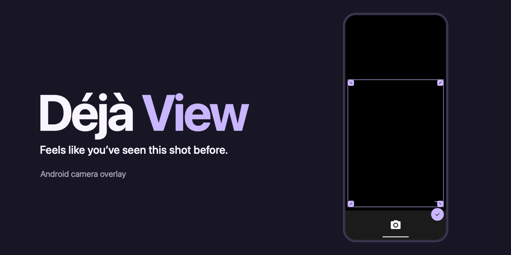

# Déjà View

**Line up your next photo with a reference.** Déjà View is an Android camera overlay for matching a previous angle, repeating a composition, or keeping before-and-after shots consistent. The floating bubble keeps the reference controls within reach while you use your camera app.



## Get started

1. Open Déjà View and allow **Display over other apps**.
2. Enable **Follow camera** during setup, or tap **Not now** to start with photo-based framing.
3. Open your camera, tap the floating bubble, and choose a reference photo.
4. Adjust the frame, photo position, and opacity. Tap **✓** to lock an edit, then take the shot in your camera app.

[Read the quick manual](docs/guide.md) for the frame controls, camera compatibility, and Quick Settings tile.

## What you can adjust

- **Frame** — Auto, 16:9, 4:3, 1:1, or Free. Drag to reposition and pull any corner to resize.
- **Photo** — Pan, pinch to zoom, change opacity, or briefly hide the reference to check the live view.
- **Camera following** — With Android Accessibility enabled, Auto can use preview bounds or mode information that the camera exposes. Photo fit is available as a fallback.
- **Quick Settings** — Add a Déjà View tile to switch the overlay on or off.

Déjà View uses Android’s image picker and keeps a copy of the selected reference in private app storage. Camera following reads layout information on the device. Your camera app saves the shot.

## Build from source

The app runs on Android 11 or later. To build it, use JDK 25 and install the Android SDK Platform for API 37. Open the project in Android Studio or set `ANDROID_HOME` to your SDK directory, then run the following command.

```sh
./gradlew assembleDebug lintDebug
```

On Windows, use `gradlew.bat`. The debug APK is generated at `app/build/outputs/apk/debug/app-debug.apk`.
