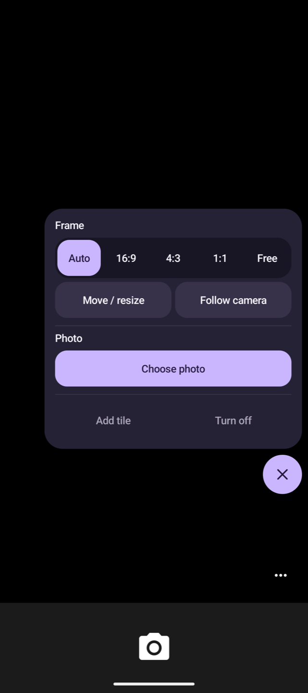

# Déjà View quick manual

## Set up

1. Open Déjà View and allow **Display over other apps** for Déjà View in Android Settings.
2. For automatic camera framing, tap **Open Accessibility** and enable **Déjà View camera framing**. Tap **Not now** to use photo fit. You can enable camera following later from **Follow camera** in the bubble menu.
3. Return to your camera app. Drag the Déjà View bubble if it covers a camera control.

## Line up a shot

| Control | What to do |
| --- | --- |
| **Choose photo** | Pick a reference in the Android photo picker. |
| **Auto** | Follow the camera preview when Déjà View can read it. The Frame heading shows **Photo fit** when the selected image determines the frame. |
| **16:9**, **4:3**, **1:1**, **Free** | Choose a fixed ratio or a freely adjustable frame. |
| **Move / resize** | Drag inside the frame to move it. Drag a corner marker to resize it. Use **Maximize** in a manual mode to fill the available space at that ratio. |
| **Pan / zoom** | Drag the reference within the frame or pinch to zoom. |
| **Opacity** | Lower it to see more of the live view. Use **Hide photo** to compare the live view on its own, or **Reset photo** to restore the reference position and zoom. |

Tap the bubble’s **✓** to lock the frame or photo after editing. In locked mode, the camera receives taps through the guide. Move the bubble clear of the shutter if needed. [See the frame markers on a blank camera preview](images/deja-view-frame-markers.png).

## Switch the overlay off

Tap **Turn off** in the bubble menu or use the **Déjà View** Quick Settings tile. To set up the tile, tap **Add tile** in the menu. You can also find it by editing the tiles in Android Quick Settings.

## If the preview looks different

Camera apps expose different preview information. If Auto cannot find a match, choose a ratio and use **Move / resize** to align the frame by hand. Some apps and system screens hide overlays. Déjà View can reappear when you return to a screen that allows them.
